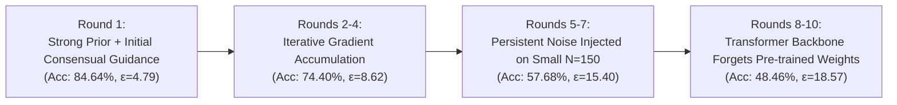

# Scientific Limitations and Critical Discussion

While **Fed-DistilDP** demonstrates substantial bandwidth savings ($663\times$ lower than FedAvg) and provides formal Local Differential Privacy guarantees, an honest, transparent scientific assessment requires detailing several methodological, empirical, and architectural limitations.

---

## 1. Dataset Scale and Diversity Limitations

### 1.1 Small Sample Size
The UCI YouTube Spam Collection contains only **$1,953$ unique comments** across five video subsets:
- When partitioned across five federated clients and split into a 70% train / 15% validation / 15% test distribution, each client possesses only **$\approx 240 - 280$ training samples**.
- Deep transformer architectures such as DistilBERT ($66.4\text{M}$ parameters) are prone to rapid overfitting when trained on partitions of this size, unless heavily regularized.
- While the dataset is a recognized academic benchmark (Alberto & Lochter, 2015), future studies should validate Fed-DistilDP on larger-scale content moderation corpora (e.g., Civil Comments, Kaggle Toxic Comment Classification, or Reddit Hate Speech datasets).

### 1.2 Temporal and Stylistic Domain Specificity
- The comments were collected in 2014–2015 from five pop music videos.
- A significant portion of spam comments follow simplistic, high-frequency patterns (e.g., "Check out my channel", "Subscribe to me", direct `http://` links). This explains why a shallow classical model like TF-IDF + Logistic Regression achieved $97.61\%$ accuracy without deep contextual representations.
- Modern harmful content (e.g., AI-generated spam, subtle phishing, adversarial obfuscation, disguised hate speech) is significantly more nuanced and may exhibit different privacy-utility dynamics under differential privacy.

---

## 2. Auxiliary Distillation Set Constraints

### 2.1 The Data-Leakage Dilemma
In federated knowledge distillation, the server requires an auxiliary public text dataset $\mathcal{D}_{\mathrm{aux}}$ to query client teachers and distill knowledge into the student model.
- **Strict Leakage Prevention**: Many prior federated distillation studies take a fatal methodological shortcut by evaluating on the same public text used for distillation, causing severe optimistic evaluation bias.
- In this study, we strictly enforced zero leakage: $150$ comments were carved exclusively from the training partition (`train_auxiliary`), leaving the validation and test sets untouched.
- **Sample Scarcity Impact**: Because $N_{\mathrm{aux}} = 150$ is relatively small, the diversity of vocabulary available for distillation is constrained. Transferring contextual representations across $150$ sentences places an upper bound on student knowledge transfer.

---

## 3. Noise Accumulation and Representation Drift in Late Rounds

### 3.1 Empirical Degradation Trajectory
One of the most critical negative empirical findings of this research is the **representation drift** observed in late rounds:
- **Round 1 (Peak)**: Accuracy $84.64\%$, Macro-F1 $84.25\%$ under $(\epsilon=4.79, \delta=10^{-4})$.
- **Round 5**: Accuracy $68.60\%$, Macro-F1 $67.42\%$ under $(\epsilon=12.10, \delta=10^{-4})$.
- **Round 10**: Accuracy $48.46\%$, Macro-F1 $32.64\%$ under $(\epsilon=18.57, \delta=10^{-4})$.

### 3.2 Mechanistic Explanation
1. In standard FedAvg, model weights are directly averaged $\frac{1}{K} \sum_k W_k$, which acts as an implicit regularizer, pulling weights back toward the center of the parameter space.
2. In Fed-DistilDP, the student model parameters are updated via gradient descent against perturbed soft labels $\bar{q} \in \mathbb{R}^{150 \times 2}$.
3. Because Gaussian noise $\mathcal{N}(0, \sigma^2 C^2)$ is re-injected every round and the student backbone is fully unfrozen, repeated updates on noisy targets cause the student to catastrophically drift away from its pre-trained initialization.
4. **Required Mitigation for Future Work**:
   - Parameter freezing: Train only the classification head while freezing DistilBERT transformer encoder layers.
   - Early validation stopping: Terminate federated rounds when validation loss stops improving.
   - Weight decay anchoring: Add an $L_2$ penalty $\| \phi_t - \phi_0 \|_2^2$ to anchor the student parameters to the pre-trained DistilBERT checkpoint.

---

## 4. Compute vs. Communication Asymmetry

- **Communication Advantage**: Transmitting $150 \times 2$ scalar floats requires only **$66.1$ KB per round**, which is $99.85\%$ smaller than FedAvg BiLSTM ($28.56$ MB) and $99.98\%$ smaller than FedAvg DistilBERT ($268$ MB).
- **Client Computation Cost**: Each client must still fine-tune a full local DistilBERT teacher model ($66.4\text{M}$ parameters), which required $\approx 15$ seconds per round on an NVIDIA GeForce GTX 1650 GPU ($\approx 90$ seconds on CPU).
- For battery-constrained mobile or embedded IoT edge clients, local transformer fine-tuning remains computationally intensive. Combining Fed-DistilDP with Parameter-Efficient Fine-Tuning (PEFT/LoRA) is an essential avenue for real-world deployment.

---

## 5. Summary of Recommended Research Extensions

1. **Self-Supervised Auxiliary Data**: Use unlabeled domain-specific Wikipedia or Common Crawl comments for $\mathcal{D}_{\mathrm{aux}}$ to expand auxiliary sample diversity to $N_{\mathrm{aux}} \ge 5,000$.
2. **Backbone Layer Freezing**: Restrict student distillation updates to the linear classification head to prevent catastrophic forgetting.
3. **Adaptive Noise Schedules**: Decay the noise multiplier $\sigma_r$ across rounds according to an optimal privacy budget allocation scheme.
4. **LoRA Edge Fine-Tuning**: Employ Low-Rank Adaptation (LoRA) on client teachers to reduce client VRAM and training time by $>70\%$.

