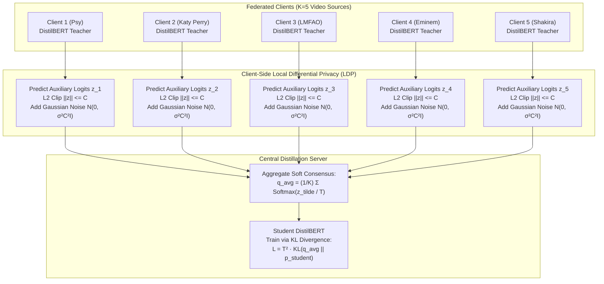

# Fed-DistilDP: Formal Methodology and Algorithmic Framework

## 1. Mathematical Formulation

Fed-DistilDP is a privacy-preserving federated knowledge distillation framework designed for harmful content detection (e.g., spam, toxicity) in decentralized environments where raw text cannot be centralized or shared across clients.



### 1.1 Local Client Training with Class-Weighted Focal Loss

Each client $k \in \{1, \dots, K\}$ possesses a private training dataset $\mathcal{D}_k = \{(x_i, y_i)\}_{i=1}^{N_k}$, where $x_i \in \mathcal{V}^*$ denotes the raw comment text and $y_i \in \{0, 1\}$ represents the ground-truth binary label ($0 = \text{Ham}$, $1 = \text{Spam}$).

Because natural comments across video sources exhibit class imbalance, each client trains its local teacher model $\theta_k$ (DistilBERT sequence classifier) by minimizing the Class-Weighted Focal Loss:

$$\mathcal{L}_{\mathrm{Focal}}(p_t) = -\alpha_t (1 - p_t)^\gamma \log(p_t)$$

Where:
- $p_t$ is the model's estimated probability for the true class:
  $$p_t = \begin{cases} p & \text{if } y = 1 \\ 1 - p & \text{if } y = 0 \end{cases}$$
- $\gamma \ge 0$ is the focusing parameter (default $\gamma = 2.0$), which dynamically down-weights well-classified easy examples and forces the gradient updates to focus on hard, ambiguous spam comments.
- $\alpha_t \in (0, 1)$ balances class frequencies:
  $$\alpha_1 = \frac{N_{\mathrm{ham}}}{N_{\mathrm{total}}}, \quad \alpha_0 = \frac{N_{\mathrm{spam}}}{N_{\mathrm{total}}}$$

---

### 1.2 Local Auxiliary Inference and $L_2$ Logit Clipping

Instead of uploading full parameter weight tensors $\theta_k \in \mathbb{R}^{67\text{M}}$ to the server (as in FedAvg), clients only evaluate their local teacher model on a small public auxiliary text dataset $\mathcal{D}_{\mathrm{aux}} = \{x_j^{\mathrm{aux}}\}_{j=1}^{N_{\mathrm{aux}}}$. Crucially, $\mathcal{D}_{\mathrm{aux}}$ is strictly drawn from training data partitions and contains **zero overlap** with validation or test splits.

For each auxiliary sample $x_j^{\mathrm{aux}}$, client $k$ computes the raw scalar logit vector:
$$z_{k, j} = f(x_j^{\mathrm{aux}}; \theta_k) \in \mathbb{R}^2$$

To enforce a strict global $L_2$ sensitivity bound for differential privacy, client $k$ applies norm clipping with threshold $C > 0$:
$$\tilde{z}_{k, j} = \frac{z_{k, j}}{\max\left(1, \frac{\|z_{k, j}\|_2}{C}\right)}$$

This guarantees that for any individual client or data sample, the $L_2$ norm satisfies:
$$\|\tilde{z}_{k, j}\|_2 \le C \quad \forall j \in \{1, \dots, N_{\mathrm{aux}}\}$$

---

### 1.3 Local Differential Privacy (LDP) Perturbation

Under Local Differential Privacy, the client perturbs the clipped logits directly on the edge device before transmitting them to the central server. The client injects zero-mean spherical Gaussian noise:
$$\hat{z}_{k, j} = \tilde{z}_{k, j} + \mathcal{N}\left(0, \sigma^2 C^2 I_2\right)$$

Where:
- $C$ is the $L_2$ clipping bound ($C = 2.0$).
- $\sigma$ is the noise multiplier ($\sigma = 1.0$ in the primary configuration).
- $\Delta_2 = C$ represents the global $L_2$ sensitivity.

The perturbed logit vector $\hat{z}_{k} \in \mathbb{R}^{N_{\mathrm{aux}} \times 2}$ is transmitted to the central server.

---

### 1.4 Server Consensus Aggregation & Student Distillation

Upon receiving perturbed logits $\{\hat{z}_k\}_{k=1}^K$ from all $K$ clients, the central server computes temperature-scaled soft probability distributions for each client:
$$q_{k, j}(c) = \frac{\exp\left(\hat{z}_{k, j}(c) / T\right)}{\sum_{c'=0}^1 \exp\left(\hat{z}_{k, j}(c') / T\right)}, \quad c \in \{0, 1\}$$

Where $T \ge 1.0$ is the distillation temperature (default $T = 2.0$), softening the output distributions to transfer inter-class dark knowledge.

The server aggregates the client distributions into an ensemble teacher consensus:
$$\bar{q}_j(c) = \frac{1}{K} \sum_{k=1}^K q_{k, j}(c)$$

The central student model $f(\cdot; \phi)$ is trained on $\mathcal{D}_{\mathrm{aux}}$ by minimizing the Kullback-Leibler (KL) Divergence against the noisy consensus:
$$\mathcal{L}_{\mathrm{Distill}}(\phi) = T^2 \cdot \frac{1}{N_{\mathrm{aux}}} \sum_{j=1}^{N_{\mathrm{aux}}} D_{\mathrm{KL}}\left(\bar{q}_j \,\|\, p_j^{\mathrm{student}}(\phi; T)\right)$$

Where $p_j^{\mathrm{student}}(c; T) = \frac{\exp\left(f(x_j^{\mathrm{aux}}; \phi)_c / T\right)}{\sum_{c'=0}^1 \exp\left(f(x_j^{\mathrm{aux}}; \phi)_{c'} / T\right)}$, and the $T^2$ scaling factor ensures gradient magnitude consistency across varying temperatures.

---

### 1.5 Rényi Differential Privacy (RDP) Composition

To account for cumulative privacy loss over $R$ communication rounds, we employ Rényi Differential Privacy (RDP).

For a Gaussian mechanism with noise multiplier $\sigma$, the RDP of order $\alpha > 1$ for a single round release is given analytically by:
$$\epsilon_{\mathrm{RDP}}(\alpha) = \frac{\alpha}{2 \sigma^2}$$

By the linear additivity property of RDP under adaptive composition across $R$ rounds:
$$\epsilon_{\mathrm{total}}(\alpha) = \sum_{r=1}^R \epsilon_{\mathrm{RDP}}^{(r)}(\alpha) = \frac{R \cdot \alpha}{2 \sigma^2}$$

The overall RDP guarantee is converted to the canonical $(\epsilon, \delta)$-DP definition by optimizing over all candidate orders $\alpha \in [1.1, 100]$:
$$\epsilon(\delta) = \min_{\alpha > 1} \left( \epsilon_{\mathrm{total}}(\alpha) + \frac{\log(1 / \delta)}{\alpha - 1} \right)$$

For $R = 10$ rounds, $\sigma = 1.0$, and target failure probability $\delta = 10^{-4}$, the optimal order $\alpha^* \approx 5.29$ yields:
$$\epsilon \approx 18.57, \quad \delta = 10^{-4}$$

At Round 1 (peak utility checkpoint):
$$\epsilon \approx 4.79, \quad \delta = 10^{-4}$$

---

## 2. Algorithmic Workflow

```
Algorithm 1: Fed-DistilDP Framework
--------------------------------------------------------------------------------
Input: 
  Clients k = 1...K with local datasets D_k;
  Public auxiliary text D_aux of size N_aux;
  Communication rounds R; Local epochs E_local; Distillation epochs E_distill;
  Clipping bound C; Noise multiplier sigma; Temperature T; Focal gamma.
Output:
  Trained Central Student Model phi_R.

1: Initialize student model phi_0 and local teacher models theta_k_0
2: For round r = 1 to R do:
3:   For each client k in parallel do:
4:     # Step 1: Local Fine-Tuning with Class-Weighted Focal Loss
5:     theta_k_r <- LocalTrain(theta_k_{r-1}, D_k, E_local, gamma)
6:     # Step 2: Auxiliary Logit Extraction & L2 Clipping
7:     z_k <- PredictLogits(theta_k_r, D_aux)
8:     z_tilde_k <- ClipNorm(z_k, C)
9:     # Step 3: Local DP Perturbation
10:    z_hat_k <- z_tilde_k + GaussianNoise(mean=0, std=sigma * C)
11:    Send z_hat_k to Central Server
12:  End For
13:  # Step 4: Server Aggregation
14:  Compute q_bar = (1/K) * Sum_{k=1}^K Softmax(z_hat_k / T)
15:  # Step 5: Student Distillation
16:  phi_r <- TrainStudent(phi_{r-1}, D_aux, q_bar, E_distill, T)
17:  # Step 6: Privacy Accounting
18:  eps_r <- ComputeRDPToDP(rounds=r, sigma=sigma, delta=1e-4)
19: End For
20: Return phi_best (selected via early validation checkpoint)
```

